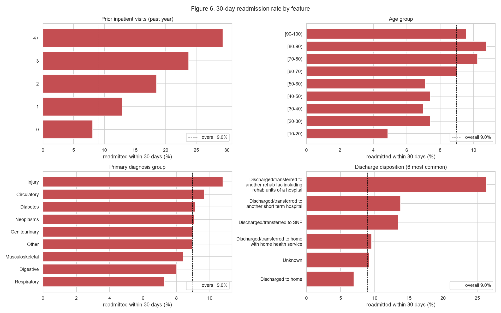

# MSCS 634 Project Deliverable 1: Data Collection, Cleaning, and Exploration

Rahul Solanki | MSCS-634-B01: Advanced Big Data and Data Mining | Professor Satish Penmatsa

Notebook: [`MSCS_634_ProjectDeliverable_1.ipynb`](MSCS_634_ProjectDeliverable_1.ipynb)

## Dataset

**Diabetes 130-US Hospitals for Years 1999-2008** (Strack et al., 2014), [UCI Machine Learning Repository, ID 296](https://archive.ics.uci.edu/dataset/296/diabetes+130-us+hospitals+for+years+1999-2008), license CC BY 4.0.

- 101,766 hospital stays of diabetic patients at 130 US hospitals, 50 attributes: demographics, admission details, lab/procedure/medication counts, three ICD-9 diagnosis codes, 23 diabetes medications, and the readmission outcome.
- Chosen because it is large, messy in realistic ways, and supports all four project deliverables: regression (length of stay), classification (30-day readmission), clustering (patient profiles) and association rules (medication combinations).

| File | Contents |
|---|---|
| `data/diabetic_data.csv` | original data from UCI |
| `data/IDS_mapping.csv` | labels for the admission type, discharge disposition and admission source codes |
| `data/diabetic_data_clean.csv` | cleaned output: 69,970 rows x 47 columns |
| `figures/` | the seven EDA figures from the notebook |

## Cleaning steps

| Step | Rows | Columns |
|---|---|---|
| Raw data | 101,766 | 50 |
| `?` to missing; drop `weight` (96.9% missing) and `payer_code` (39.6%); `Missing`/`Unknown` category for `medical_specialty` (49.1%) and `race` (2.2%) | 101,766 | 48 |
| Keep each patient's first encounter (30,248 repeat stays removed) | 71,518 | 48 |
| Drop 3 invalid-gender rows and 1,545 stays ending in death or hospice (cannot be readmitted) | 69,970 | 48 |
| Map ID codes to labels, merge four "unknown" codes into one, drop 3 constant medication columns, add numeric `age_mid` | 69,970 | 46 |
| Group about 700 ICD-9 codes per diagnosis column into 9 disease groups; merge rare specialties into `Other` | 69,970 | 46 |
| Add binary target `readmit_30` | 69,970 | 47 |

Outliers were checked with the IQR rule and **kept**: every value is valid, and for the prior-visit counts (Q1 = Q3 = 0) the rule flags every patient with any prior visit, which is the high-risk group the models need.

## Key insights



- **Imbalanced target:** only 9.0% of patients are readmitted within 30 days (59.3% never, 31.8% after 30 days).
- **Prior inpatient visits are the strongest signal:** the 30-day rate rises from 8.1% with no prior visits to 29.3% with 4 or more.
- **Discharge destination matters:** 6.9% for patients sent home vs. 13.4% to a skilled nursing facility and 26.3% to a rehab facility. Risk also rises with age (7.1% at 50-60, 10.8% at 80-90).
- **Weak linear signal:** no numeric feature correlates with the target above 0.085 (Spearman), while the A1C test result barely changes the rate (8.2% to 9.1%).
- **Length of stay** tracks the number of medications (median 10 at 1 day, 24 at 14 days) and lab tests (35 to about 57).
- **Medications:** insulin (51.0%) and metformin (21.3%) dominate; only 8 of 20 medication columns are used by at least 1% of patients.

**How this guides modeling:** stratified splits with class weights and recall/F1/AUC instead of accuracy; non-linear models such as trees and ensembles; one-hot encoding for nominal columns and ordinal encoding for age and dose changes; `log1p` plus scaling for linear models and k-means; association rules limited to the 8 common medications.

## Challenges and how they were addressed

- **Hidden missing values.** Missing data is written as `?`, `Unknown/Invalid`, or one of four "unknown" ID labels. All were found and turned into NaN or one `Unknown` label.
- **`None` is not missing.** By default pandas reads the text `None` (test not performed) as NaN, which would have erased 94.7% of `max_glu_serum` and 83.3% of `A1Cresult`. The file is loaded with `keep_default_na=False`, and the value is renamed `Not tested`.
- **Repeat patients.** 30% of rows were repeat stays of the same people. Keeping only the first stay keeps rows independent and prevents patient-level leakage between training and test sets.
- **Messy mapping file.** `IDS_mapping.csv` stacks three tables in one CSV, and its labels have stray spaces and periods. A small parser splits the tables and cleans 24 labels.
- **Hundreds of diagnosis codes.** About 700 ICD-9 codes per column were grouped into 9 clinical categories using the ranges from Strack et al. (2014).

## How to run

```bash
pip install pandas numpy matplotlib seaborn jupyter
jupyter notebook MSCS_634_ProjectDeliverable_1.ipynb
```

## Reference

Strack, B., DeShazo, J. P., Gennings, C., Olmo, J. L., Ventura, S., Cios, K. J., & Clore, J. N. (2014). Impact of HbA1c measurement on hospital readmission rates: Analysis of 70,000 clinical database patient records. *BioMed Research International, 2014*, Article 781670. https://doi.org/10.1155/2014/781670
